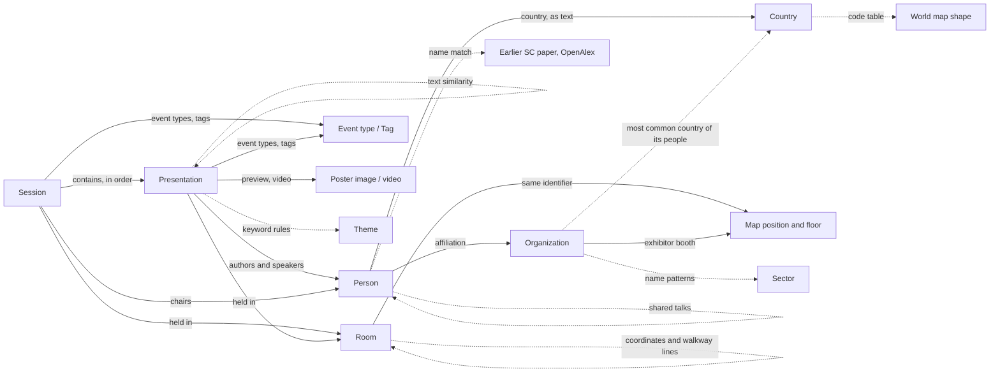

# Source inventory for SC26 Atlas

This folder records what information the app was built from, what form it
came in, and which connections between pieces of information were already in
the source versus made by the app. It describes app version 1.0.1 and the
program as downloaded on 18 November 2026, 07:31 UTC (1:31 AM Chicago time).

## Short answers

**What kind of source was it? Was it a spreadsheet?**
It was web pages. The public SC26 schedule site,
`sc26.conference-program.com`, is a WordPress site that shows the program
through a plugin made by Linklings, the company that runs the SC submission
system. Every page is HTML that the server builds. The view that looks like a
spreadsheet is an HTML table with one row per session. No spreadsheet, CSV
file, database export or program feed was downloaded. Two smaller sources
were structured data (JSON): the venue map, and OpenAlex for earlier SC papers.

**How much was already connected?**
Most of the backbone. The site prints a well-organized data set: every
session, presentation, person, organization, room, event type and tag carries
a stable identifier, and the pages point at each other with those
identifiers. The app kept those connections as they were. The table shows the
split; [links.md](links.md) has the full breakdown with counts.

| Connection you see in the app | Came from |
|---|---|
| Talk belongs to a session; session lists its talks in order with times | Source |
| Talk has authors and speakers, in order, with who is presenting | Source |
| Session has chairs | Source |
| Person belongs to one or more organizations | Source |
| Person has a country | Source (contributor index only, 92% of people) |
| Session or talk is in a room | Source |
| Room has a position on a floor plan | Source: the program and the map use the same room identifier |
| Session or talk has event types and official topic tags | Source (topic tags on 64% of presentations) |
| Poster has a preview image and sometimes a video | Source |
| One format list (Paper, Workshop, Poster, ...) in three groups | App, from the source's 27 event types |
| Duplicate people and organization spellings merged | App |
| Organization has a sector and a country | App (estimates) |
| Country has a place on the globe | App (hand-written code table plus a public world map) |
| 36 research themes | App (keyword rules written for this program) |
| "Related work", key terms, the galaxy layout, buzzwords | App (text similarity) |
| Who works with whom | App (people who share a talk) |
| Earlier SC papers per person | App (OpenAlex, matched by name) |
| Activity ranking, interest match, the built schedule | App |
| Walking minutes and walking routes | App (computed from the map's coordinates and walkway lines) |

**What could not be reached?**
Biographies, contributor photos and links to the published papers sit on
one-page-per-person and one-page-per-talk pages. The site stopped answering
this computer after a burst of requests, so only 124 session pages and one
example each of a person page and a talk page were read.
[sources.md](sources.md) lists everything that was seen but not fetched.

## Picture of the connections

Solid arrows are connections printed by the source. Dashed arrows were made
by the app.



## Files in this folder

| File | What it holds |
|---|---|
| [sources.md](sources.md) | Every source that was touched: address, format, size, what it contains, and whether it was used, sampled, blocked or left alone |
| [records.md](records.md) | The kinds of record in the source (session, presentation, person, ...), their identifiers, their fields and how complete each field is |
| [links.md](links.md) | Connections supplied by the source, connections the app did not use, connections the app built, and a screen-by-screen split |
| [counts.json](counts.json) | Every number quoted in these documents, produced by a script |
| [samples/](samples) | One short, real excerpt of each source format |

## How the numbers were produced

```bash
# counts.json and samples/ are written by this script; it reads local files only
/tmp/sc26build/venv/bin/python -I scraper/inventory.py --raw data/raw --program data/program.json --web app/web/www --out inventory
```

`data/raw` is the local cache of downloaded pages. It is not in the
repository (about 70 MB). `scraper/verify.py` separately confirms that all
407 sessions, 1,363 presentations, 3,977 contributors and 64 rooms from the
source are in the app.
